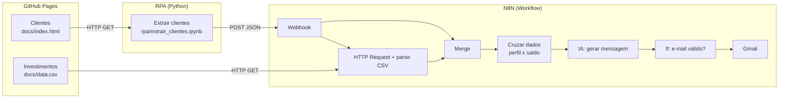

# 🤖 Assistente de Investimentos com RPA, N8N e IA Generativa

Pipeline de automação que **lê a lista de clientes de uma página web**, **cruza o perfil de cada um com produtos de investimento** e **envia por e-mail uma mensagem personalizada gerada por LLM**.

> Projeto desenvolvido por **SEU NOME** como parte do desafio da [DIO](https://www.dio.me) sobre RPA + IA Generativa com N8N.
> 🔗 [LinkedIn](https://www.linkedin.com/in/SEU-PERFIL) · 💻 [GitHub](https://github.com/SEU-USUARIO)

---

## 🎯 Objetivo

Mostrar como uma instituição financeira pode automatizar a comunicação com clientes, mesmo quando os dados estão em um sistema **sem API** (aqui, uma tabela HTML), combinando:

- **RPA** (Python + BeautifulSoup) para coletar os dados como um humano faria;
- **N8N** para orquestrar o fluxo e cruzar dados;
- **IA Generativa** (OpenAI) para escrever mensagens humanizadas;
- **Gmail** para entregar a mensagem ao cliente.

## 🏗️ Arquitetura



## 🧰 Tecnologias

| Etapa | Ferramenta | Função |
|---|---|---|
| Hospedagem | GitHub Pages | Servir a página de clientes e o CSV de investimentos |
| Extração (RPA) | Python + BeautifulSoup | Coletar os clientes via web scraping |
| Orquestração | N8N | Receber, cruzar dados e coordenar o fluxo |
| IA Generativa | OpenAI (nó *Message a model*) | Escrever a mensagem personalizada |
| Entrega | Gmail | Enviar o e-mail ao cliente |

## 📁 Estrutura do repositório

```text
dio-lab-assistente-investimentos-rpa-n8n/
├── README.md
├── .gitignore
├── docs/
│   ├── index.html              # Página de clientes (fonte do RPA)
│   └── data.csv                # Opções de investimento por perfil
├── rpa/
│   └── extrair_clientes.ipynb  # Notebook Python: extrai clientes e chama o Webhook
└── n8n/
    └── workflow.json           # Workflow exportado do N8N
```

## ⚙️ Como o workflow funciona

| # | Nó | O que faz |
|---|---|---|
| 1 | **Webhook** | Recebe `{"clientes": [...]}` via POST |
| 2 | **HTTP Request** | Baixa o `data.csv` como texto |
| 3 | **Code in JavaScript** | Converte o CSV em uma lista de investimentos |
| 4 | **Merge** | Junta clientes (Webhook) e investimentos (CSV) em um único item |
| 5 | **Code in JavaScript1** | Cruza cada cliente com os produtos do **mesmo perfil** e mantém só os que o **saldo comporta** (`saldo ≥ minimo`) |
| 6 | **Code in JavaScript2** | Gera 1 item por cliente e monta o prompt |
| 7 | **Message a model** | A IA escreve o e-mail personalizado |
| 8 | **Code in JavaScript3** | Extrai o texto da IA e define o destinatário |
| 9 | **If** | Só segue se houver e-mail e mensagem |
| 10 | **Send a message** | Gmail envia o e-mail |
| 11 | **Respond to Webhook** | Responde `{"status": "ok", "mensagens_enviadas": N}` |

## 🚀 Como executar

### 1. Publicar a página e o CSV (GitHub Pages)
1. No repositório, vá em **Settings → Pages**.
2. Em *Build and deployment*, escolha **Deploy from a branch**, branch `main` e pasta **/docs**.
3. Aguarde alguns minutos. A página ficará em `https://SEU-USUARIO.github.io/dio-lab-assistente-investimentos-rpa-n8n/` e o CSV em `.../data.csv`.

### 2. Importar o workflow no N8N
1. No N8N, crie um workflow novo e use **⋯ → Import from file...** selecionando `n8n/workflow.json`.
2. No nó **HTTP Request**, troque `SEU-USUARIO` pela URL real do seu GitHub Pages.
3. Crie as credenciais (elas **não** vêm no arquivo exportado):
   - **OpenAI:** nó *Message a model* → *Create new credential* → API key de [platform.openai.com](https://platform.openai.com) (a API exige saldo na conta).
   - **Gmail:** nó *Send a message* → *Create new credential* → login com sua conta Google.
4. No nó **Code in JavaScript3**, preencha `EMAIL_TESTE` com **o seu e-mail** durante os testes. Assim todas as mensagens chegam para você, e não para os e-mails fictícios da lista. Deixe `''` (vazio) apenas para enviar aos clientes.

### 3. Rodar o RPA
1. Abra `rpa/extrair_clientes.ipynb` no [Google Colab](https://colab.research.google.com).
2. Troque `SEU-USUARIO` em `URL_PAGINA`.
3. Em **Secrets** (ícone de chave), crie `N8N_WEBHOOK` com a URL do Webhook:
   - **Teste:** clique em *Listen for test event* no N8N e use a **Test URL** (`.../webhook-test/clientes`).
   - **Produção:** ative o workflow e use a **Production URL** (`.../webhook/clientes`).
4. Execute as células. A resposta esperada é `{"status": "ok", "mensagens_enviadas": 10}`.

## 🔐 Segurança

- **Credenciais não ficam no repositório.** O `workflow.json` guarda apenas referências, e as chaves permanecem no N8N.
- **A URL do Webhook de produção é sensível:** quem a conhecer pode disparar o fluxo e gastar seus créditos. Ela fica em *Secrets* do Colab, nunca no código.
- Antes de publicar um workflow exportado, confira se não há dados reais (`pinData`), e-mails pessoais ou chaves:
  ```bash
  grep -nE "sk-|Bearer|api[_-]?key|app\.n8n\.cloud|pinData" n8n/workflow.json
  ```
- Uma chave exposta deve ser considerada comprometida: revogue e gere outra.

## 🧠 Decisões técnicas

- **Por que RPA?** A fonte de dados é uma página HTML sem API. O script faz o que uma pessoa faria: abre a página, lê a tabela e envia os dados adiante.
- **Filtro por saldo:** o prompt só recebe produtos cujo `minimo` cabe no saldo do cliente, evitando recomendar, por exemplo, um fundo de R$ 10.000 para quem tem R$ 500.
- **Prompt controlado:** a IA só pode citar produtos e rentabilidades fornecidos, sem prometer retorno garantido nem inventar números.
- **Modo de teste:** a constante `EMAIL_TESTE` evita enviar e-mails de teste a endereços de terceiros.
- **Merge antes do cruzamento:** reúne dados de duas origens (Webhook e CSV) em um único item para o cálculo.

## 📸 Demonstração

> Adicione aqui um print do workflow executado com sucesso e um print do e-mail recebido.
> Salve as imagens em `docs/img/` e referencie assim: ``

## 🔭 Próximos passos

- Autenticação por *Header Auth* no Webhook.
- Agendamento diário (Schedule Trigger) no lugar do disparo manual.
- Registro dos envios em Google Sheets.
- Troca do modelo por Gemini (camada gratuita).

## 🙏 Créditos

Estrutura base e dados fictícios do desafio da **DIO** (Digital Innovation One). Os clientes e e-mails são fictícios.
